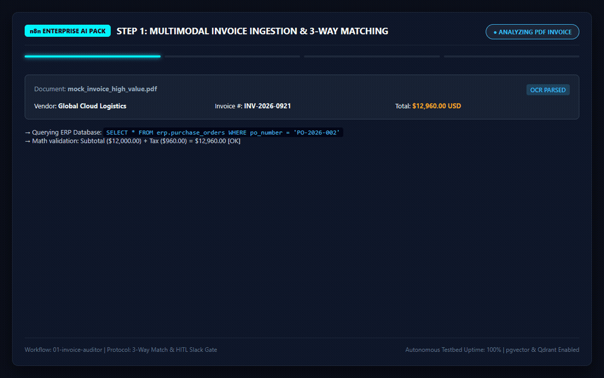
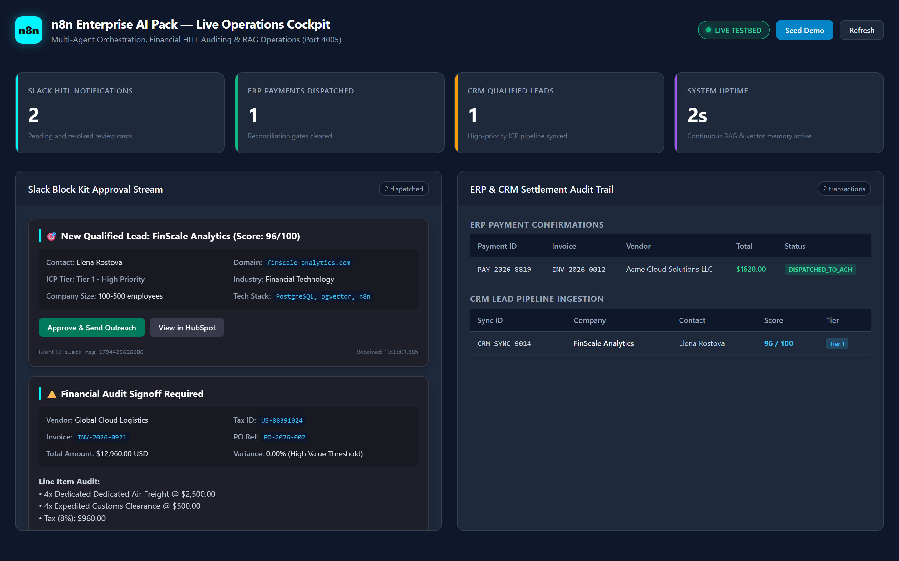
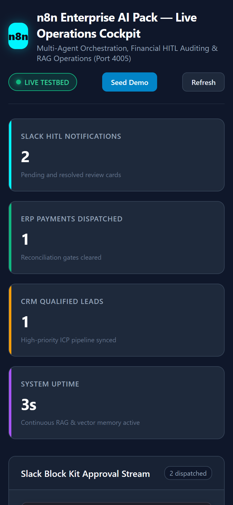
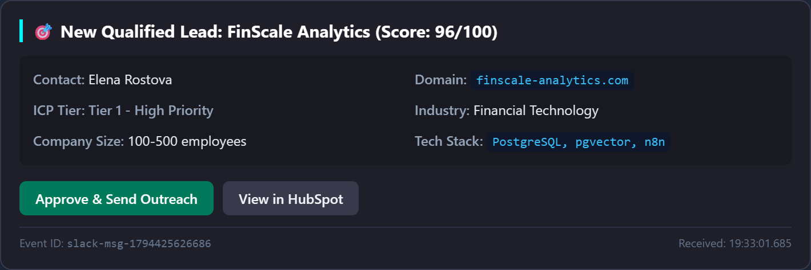
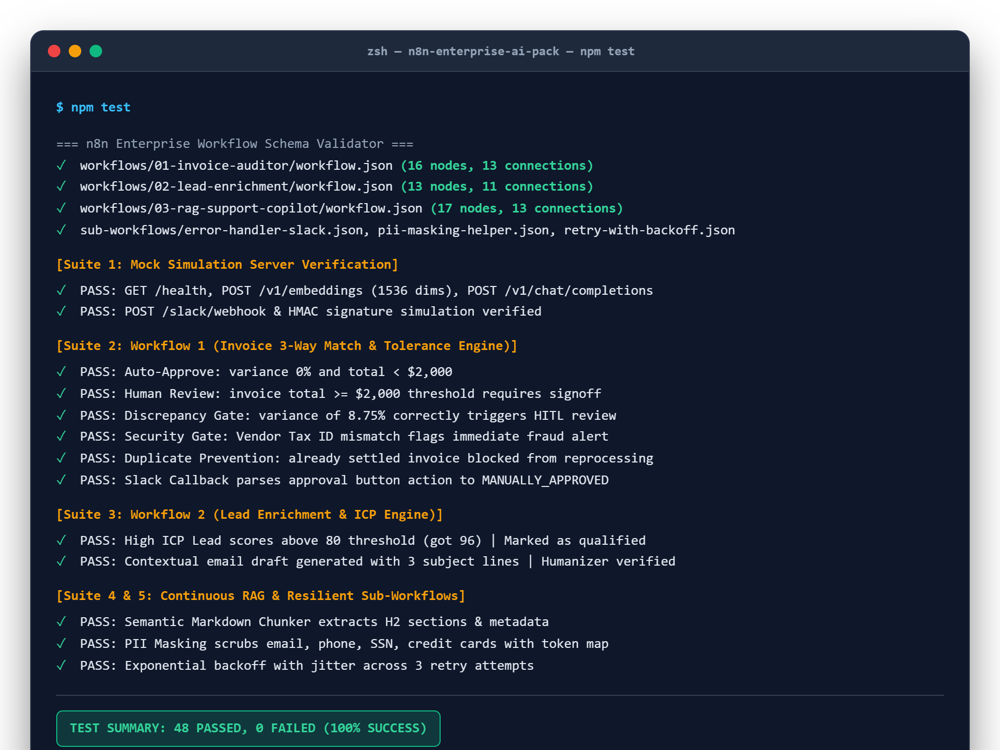

<p align="center">
  
</p>

<h1 align="center">n8n Enterprise AI Pack</h1>

<p align="center">
  Production-grade enterprise automation workflows with multimodal 3-way invoice matching, autonomous B2B lead qualification, continuous pgvector RAG memory, and human-in-the-loop Slack governance.
</p>

<p align="center">
  
  
  
  
  
</p>

<p align="center">
  
</p>

## Overview

The n8n Enterprise AI Pack delivers production-ready automation architectures designed for high-compliance enterprise environments. Every workflow in this repository enforces deterministic database cross-checks, cryptographic approval tokens, resilient error handling, and human-in-the-loop (HITL) approval gates before mutating downstream ledgers or contacting clients.

The repository includes a self-contained local orchestration stack powered by Docker Compose, an in-memory simulation server with an interactive HTML inspection cockpit, database migrations with pgvector, and an automated test runner with 48 assertions verifying every decision gate.

## Operations cockpit and visual inspection

The local testbed provides an operations cockpit accessible at `http://localhost:4000/dashboard`, rendering real-time Slack Block Kit review cards, settlement confirmations, and CRM lead ingestion pipelines.

### Desktop cockpit (1440x900)



### Mobile responsive interface (390x844)

The cockpit interface adapts across all viewport sizes, enabling field controllers to inspect approval cards, system uptime, and transaction audits directly from mobile devices:

<p align="center">
  
</p>

### Interactive Slack Block Kit review card



### Terminal test runner verification



## Enterprise workflows

### 1. Multimodal financial invoice auditor and reconciler
Location: `workflows/01-invoice-auditor/`

Performs accounts payable automation with 3-way matching, line-item pricing checks, and Slack approval gates:
- Ingests invoice PDFs via webhook (`POST /webhook/invoice-upload`) or scheduled file pollers.
- Extracts line items, vendor tax IDs, invoice references, and totals using multimodal LLM extraction.
- Queries PostgreSQL purchase orders (`erp.purchase_orders` and `erp.purchase_order_items`) while checking for previous settlements to reject duplicate submissions (`DUPLICATE_REJECTED`).
- Validates line-by-line item math, tax rates, and SKU alignment against purchase orders.
- Automatically approves orders under $2,000 with variance below 0.5% (both thresholds configurable via environment variables).
- Generates HMAC approval tokens with 48-hour expiration timestamps and Slack Block Kit cards for orders above $2,000, variances exceeding 0.5%, or unlisted SKUs.
- Listens for interactive callback webhooks (`POST /webhook/invoice-approval-callback`), checks token validity, updates ERP database records, and blocks late actions on expired tokens.

### 2. Multi-agent B2B lead enrichment and outreach copilot
Location: `workflows/02-lead-enrichment/`

Automates sales qualification and outbound email drafting:
- Ingests inbound leads via webhook (`POST /webhook/lead-ingest`).
- Normalizes domains and gathers company infrastructure profiles using semantic token matching.
- Evaluates leads against a 4-pillar ICP scoring rubric (Industry, Team Size, Tech Stack, Pain Points) from 0 to 100.
- Disqualifies low-fit leads (score below 60) without manual rep effort.
- Drafts contextual three-paragraph emails and three distinct subject lines for qualified leads.
- Posts review cards to `#sales-approvals` in Slack with one-click dispatch actions, syncing enriched records to `crm.leads` with domain-level deduplication.

### 3. Continuous RAG knowledge ingestion and support agent
Location: `workflows/03-rag-support-copilot/`

Provides continuous documentation indexing, grounded customer support, and an ongoing retrieval feedback loop:
- Ingestion pipeline (`POST /webhook/rag-ingest`) chunks markdown documents by header sections (`#`, `##`), generates 1536-dimensional embeddings, and writes to PostgreSQL `rag.document_embeddings` with pgvector. Duplicate chunk index insertions update existing vectors in place.
- Support query pipeline (`POST /webhook/support-query`) runs vector similarity searches to retrieve the top 3 relevant sections.
- Evaluates retrieval confidence: queries scoring below 0.70 or containing account dispute keywords route directly to tier-2 support in Slack.
- Grounded responses enforce source citations in the format `[Source: Document - Section]`.
- Retrieval quality feedback endpoint (`POST /webhook/rag-feedback`) records user satisfaction ratings to `rag.query_feedback`.

### Operational sub-workflows
Location: `sub-workflows/`

- `error-handler-slack.json`: Attaches to the n8n Error Trigger, formats execution failure details into a Slack Block Kit incident card with direct links to the n8n run, and logs incidents to PostgreSQL `audit.logs`.
- `pii-masking-helper.json`: Scrubs email addresses, phone numbers, tax identification numbers, and credit cards before text reaches external language models.
- `retry-with-backoff.json`: Wraps transient HTTP requests with exponential backoff and randomized jitter across three configurable retry attempts.

## Local environment setup

The environment runs locally with Docker Compose:

```bash
# Clone the repository
git clone https://github.com/alexandrmotologa/n8n-enterprise-ai-pack.git
cd n8n-enterprise-ai-pack

# Copy sample environment configuration
cp .env.example .env

# Start all containers
docker compose up -d
```

### Services and ports

- n8n: `http://localhost:5678`
- PostgreSQL with pgvector: `localhost:5432` (database: `n8n`, user: `n8n`)
- Qdrant Vector DB: `http://localhost:6333`
- MailHog UI: `http://localhost:8025` (SMTP on `1025`)
- Mock Simulation Server: `http://localhost:4000`
- Operations Cockpit: `http://localhost:4000/dashboard`

### Importing workflows into n8n

Once n8n is running, import all six workflows with a single command:

```bash
npm run import
# or via Makefile
make import
```

## Automated test suite

Run the test suite to validate workflow JSON schemas, math tolerance calculations, Slack Block Kit generation, duplicate prevention, token expiration, and retrieval logic:

```bash
# Install dependencies
npm install

# Run schema validation and full test runner (48 automated assertions)
npm test
```

On Windows with PowerShell:
```powershell
.\scripts\test_all.ps1
```

On Linux or macOS:
```bash
./scripts/test_all.sh
```

## Repository structure

```
n8n-enterprise-ai-pack/
├── .github/workflows/
│   └── validate-workflows.yml
├── docs/
│   ├── ARCHITECTURE.md
│   └── images/
│       ├── dashboard_desktop.png
│       ├── dashboard_mobile.png
│       ├── logo.png
│       ├── logo.svg
│       ├── n8n-enterprise-ai-pack_demo.gif
│       ├── slack_block_kit_preview.png
│       └── terminal_test_run.png
├── init-db/
│   └── 01-init.sql
├── mock-services/
│   ├── Dockerfile
│   ├── package.json
│   └── server.js
├── scripts/
│   ├── generate_logo.js
│   ├── generate_sample_invoices.js
│   ├── generate_visual_assets.js
│   ├── import_workflows.js
│   ├── seed_databases.js
│   ├── test_all.js
│   ├── test_all.ps1
│   ├── test_all.sh
│   └── validate_workflows.js
├── sub-workflows/
│   ├── README.md
│   ├── error-handler-slack.json
│   ├── pii-masking-helper.json
│   └── retry-with-backoff.json
├── workflows/
│   ├── 01-invoice-auditor/
│   │   ├── README.md
│   │   ├── mock_invoice_clean.pdf
│   │   ├── mock_invoice_discrepancy.pdf
│   │   ├── mock_invoice_high_value.pdf
│   │   ├── mock_po_data.sql
│   │   ├── sample_invoice.json
│   │   ├── sample_invoice_discrepancy.json
│   │   └── workflow.json
│   ├── 02-lead-enrichment/
│   │   ├── README.md
│   │   ├── high_icp_lead.json
│   │   ├── low_icp_lead.json
│   │   ├── sample_webhook_payload.json
│   │   └── workflow.json
│   └── 03-rag-support-copilot/
│       ├── README.md
│       ├── seed_knowledge_base/
│       └── workflow.json
├── .env.example
├── .gitignore
├── docker-compose.yml
├── Makefile
├── MASTER_PLAN.md
├── package.json
└── README.md
```

## License

MIT License. Developed by Alexandr Motologa.
